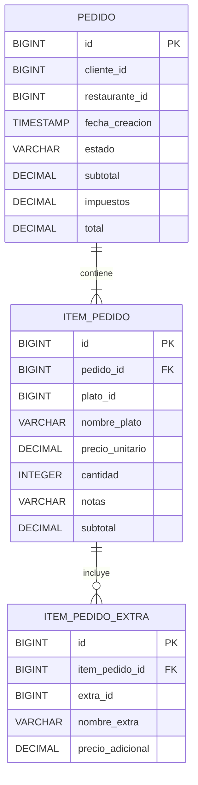

# FoodExpress – Modelo de datos del microservicio Pedidos

## 1. Objetivo

El microservicio Pedidos administra la creación y consulta de pedidos realizados por los clientes a los restaurantes registrados en FoodExpress.

Permite crear pedidos con uno o varios platos, personalizar cada ítem mediante extras y notas especiales, calcular los valores correspondientes y conservar la información histórica de cada pedido.

La construcción de los pedidos se realizará mediante el patrón de diseño Builder.

## 2. Entidades

### 2.1. Pedido

Representa un pedido realizado por un cliente a un restaurante.

| Atributo | Tipo de dato | Descripción |
|---|---|---|
| id | BIGINT | Identificador único del pedido. |
| cliente_id | BIGINT | Identificador del cliente. |
| restaurante_id | BIGINT | Identificador del restaurante. |
| fecha_creacion | TIMESTAMP | Fecha y hora de creación. |
| estado | VARCHAR(30) | Estado actual del pedido. |
| subtotal | NUMERIC(12,2) | Suma de los valores de los ítems. |
| impuestos | NUMERIC(12,2) | Valor de los impuestos calculados. |
| total | NUMERIC(12,2) | Valor final del pedido. |

**Reglas:**
- Todo pedido debe pertenecer a un cliente y a un restaurante.
- Un pedido debe contener al menos un ítem.
- El estado inicial será `RECIBIDO`.
- El subtotal se calcula a partir de los ítems y sus extras.
- El total corresponde al subtotal más los impuestos.
- Los valores monetarios se almacenan con precisión decimal.
- La solicitud de creación debe incluir al menos un ítem, validación realizada en el DTO de entrada.

### 2.2. ItemPedido

Representa cada plato incluido dentro de un pedido.

| Atributo | Tipo de dato | Descripción |
|---|---|---|
| id | BIGINT | Identificador único del ítem. |
| pedido_id | BIGINT | Referencia al pedido al que pertenece. |
| plato_id | BIGINT | Identificador del plato en Restaurantes y Menú. |
| nombre_plato | VARCHAR(120) | Nombre del plato al momento de realizar el pedido. |
| precio_unitario | NUMERIC(12,2) | Precio del plato al momento de realizar el pedido. |
| cantidad | INTEGER | Cantidad solicitada. |
| notas | VARCHAR(500) | Indicaciones especiales del cliente. |
| subtotal | NUMERIC(12,2) | Valor del ítem incluyendo sus extras y cantidades. |

**Reglas:**
- Cada ítem pertenece a un único pedido.
- La cantidad debe ser mayor que cero.
- El plato debe existir y estar disponible al momento de crear el pedido.
- El precio y el nombre del plato se conservan como una copia histórica.
- Las notas son opcionales.

### 2.3. ItemPedidoExtra

Representa los extras seleccionados para un ítem específico.

| Atributo | Tipo de dato | Descripción |
|---|---|---|
| id | BIGINT | Identificador único del registro. |
| item_pedido_id | BIGINT | Referencia al ítem del pedido. |
| extra_id | BIGINT | Identificador del extra en Restaurantes y Menú. |
| nombre_extra | VARCHAR(100) | Nombre del extra al momento del pedido. |
| precio_adicional | NUMERIC(12,2) | Precio adicional histórico del extra. |

**Reglas:**
- Cada extra seleccionado pertenece a un ítem del pedido.
- El extra debe estar disponible y asociado al plato correspondiente.
- El nombre y el precio se conservan como una copia histórica.
- - Un mismo extra no puede seleccionarse más de una vez dentro del mismo ítem del pedido.

## 3. Relaciones entre entidades

- Un Pedido contiene uno o varios ItemPedido.
- Un ItemPedido pertenece a un único Pedido.
- Un ItemPedido puede contener cero o varios ItemPedidoExtra.
- Un ItemPedidoExtra pertenece a un único ItemPedido.

## 4. Diagrama entidad-relación

## 5. Integración con otros microservicios

El microservicio Pedidos se comunica con Restaurantes y Menú para consultar la información necesaria antes de registrar un pedido.

Los identificadores `cliente_id`, `restaurante_id`, `plato_id` y `extra_id` representan referencias a información administrada por otros componentes del sistema.

No se crean relaciones físicas ni relaciones JPA entre las bases de datos de los diferentes microservicios.

Antes de guardar el pedido se debe verificar:

1. Que el restaurante exista y esté activo.
2. Que los platos existan y estén disponibles.
3. Que los platos pertenezcan al restaurante seleccionado.
4. Que los extras estén disponibles y asociados a sus respectivos platos.

Los precios y nombres obtenidos del menú se guardan como datos históricos en las entidades del pedido.

## 6. Cálculos

El subtotal de cada ítem se obtiene sumando el precio del plato y los precios de sus extras, multiplicando el resultado por la cantidad solicitada.

El subtotal del pedido corresponde a la suma de los subtotales de todos sus ítems.

Los impuestos se calculan mediante una tasa configurable. Mientras el equipo no defina una tasa, el valor inicial será cero.

El total corresponde a la suma del subtotal y los impuestos.

## 7. Estado del pedido

El pedido tendrá un atributo `estado` para almacenar su situación actual.

El estado inicial será `RECIBIDO`.

Los estados contemplados por el proyecto son:

- RECIBIDO
- EN_PREPARACION
- LISTO
- ENTREGADO
- CANCELADO

La implementación de las transiciones y del patrón State corresponde al integrante responsable de esa funcionalidad.

## 8. Reglas de integridad

1. Todo pedido debe tener un cliente y un restaurante.
2. Todo pedido debe contener al menos un ítem.
3. La cantidad de cada ítem debe ser mayor que cero.
4. Los precios y valores calculados no pueden ser negativos.
5. Los platos deben pertenecer al restaurante seleccionado.
6. Los platos deben estar disponibles al momento de crear el pedido.
7. Los extras deben estar asociados a los platos correspondientes.
8. Los extras deben estar disponibles al momento de crear el pedido.
9. Los nombres y precios deben conservarse como datos históricos.
10. El subtotal y el total deben calcularse en el backend, sin confiar en valores enviados por el cliente.

## 9. Patrón de diseño

Se utilizará el patrón Builder para construir objetos Pedido de manera organizada.

El Builder permitirá configurar los datos generales del pedido, agregar los ítems, incorporar sus extras y notas especiales, y construir el objeto final después de realizar las validaciones correspondientes.

## 10. Alcance de implementación

Este modelo corresponde al trabajo del microservicio Pedidos y contempla la persistencia de pedidos, ítems y extras seleccionados.

La máquina de estados, las notificaciones y la mensajería asíncrona serán desarrolladas por los integrantes responsables de esas funcionalidades.

**Estado del documento:** modelo implementado en el microservicio Pedidos y validado mediante pruebas funcionales y de persistencia. Las funcionalidades de State, RabbitMQ y Notificaciones continúan bajo responsabilidad de los integrantes correspondientes.